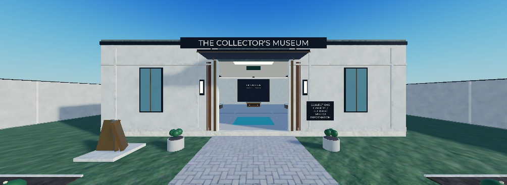
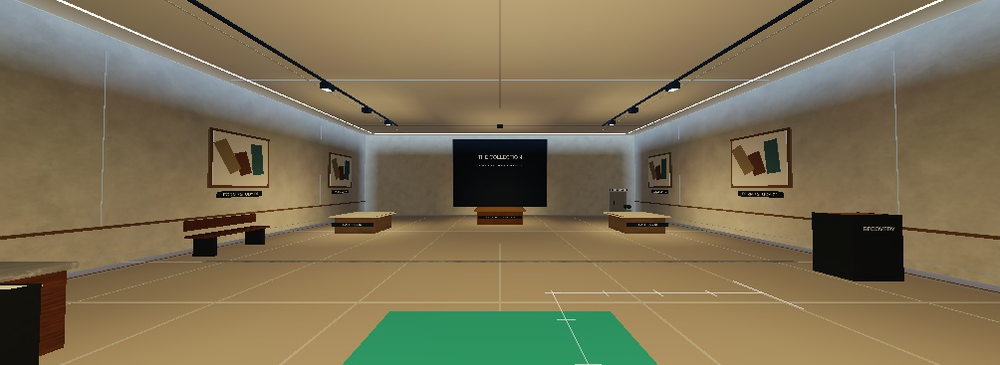

# Task 11 visual implementation report

**12 October 2026 — visual kit version 3 baseline.** The later [environment follow-up](task11-environment-followup.md) adds edge ridges, denser planting, the acquisition pavilion, dusk lighting and sit-only benches as visual kit v4. The measurements below describe v3 unless specifically stated otherwise.

## What changed

- **Exterior:** warm ivory facade, stone base bands, pilasters, bronze accents, framed opaque glazing, entrance canopy and readable sign, paired planters and lamps, offset abstract sculpture, roof coping, skylight and utility equipment. The feature sculpture sits beside the entrance lane.
- **Interior:** warm stone floor finish, wall molding, four original abstract artworks and captions, reception counter, brochure stand, museum map, seating, plants, service details, protected-display feature wall, three existing stand labels and edges, lighter ceiling panels, two track assemblies and focused exhibit lighting. No new exhibit sockets or security gameplay were added.
- **Backyards:** private patio and planting, grouped service equipment, utility screen, crate/pallet, drain, maintenance plaque and rear service facade. These do not create delivery interactions.
- **Six landscapes:** formal garden, naturalistic garden, sculpture garden, classical estate, contemporary minimalist and urban collector. Presets are deterministic, use the museum's pivot, and rotate with each plot. Low planting and matching tree positions keep access and sightlines comparable.
- **Shared district:** one central collection depot, plaza paving and borders, bronze monument, identity and direction signs, benches, planters, lamps, depot framing, existing pedestal labels, logistics details, public-path edging and paving, covered-route treatment, peripheral trees and estate edges.
- **Lighting:** restrained afternoon settings, readable gallery ambient light, limited actual fixtures, subdued bloom, disabled depth of field, and one atmosphere. Nighttime was inspected temporarily; no day/night cycle was added.
- **Surface cleanup:** removed duplicate legacy visual layers during refresh. Thin floor and paving lines were widened and separated from their surfaces after screenshot inspection showed shimmer.

All art is made from original Roblox Parts and materials. No Toolbox models, outside scripts, textures or purchased asset IDs are required.

## Geometry audit and preservation

The existing source pack, old playable map, route definitions, sockets and Lighting were inspected before the v3 changes. Functional objects retain their existing parents and names. The source pack is Studio-owned under `ServerStorage/Assets/Task11MapTemplates`; Rojo owns the code and preserves unknown generated instances there. Existing Rojo mappings were not changed.

| Audited property | Preserved value |
| --- | --- |
| Starter hall footprint | 60 × 60 studs; 19-stud structural height |
| Hall bounding-box center | (0, 9.8, 0) |
| Museum pivot / front | (0, 0, 0), facing local −Z |
| Full template bounds, including expansion anchors | 171 × approximately 20.9 × 171 |
| Used starter grounds / maximum reservation | 120 × 120 / 280 × 280 |
| Hall doorway / grounds gate width | 14 / 16 studs |
| Receiving zone center | (0, 3, −20) |
| Protected socket / exposed sockets | (0, 4.5, 17) / (−18, 4.5, 8), (18, 4.5, 8) |
| Spawn / recovery / approach | (0, 3, 25) / (−23, 3.3, −10) / (0, 3, −35) |
| Socket count / display count | 25 / 3 |
| World ground | 1,000 × 1,080 studs |

Plot centers and rotations are unchanged: 01 (0,360)/0°, 02 (320,180)/90°, 03 (320,−180)/90°, 04 (0,−360)/180°, 05 (−320,−180)/−90°, 06 (−320,180)/−90°. Dimensions were taken from the existing instances, not recalculated from proposed tier targets.

`scripts/audit_task11_geometry.luau` compares non-art part paths, sizes, transforms, collision/touch/query flags and sorted attributes. Before and after fingerprints match exactly:

| Root | Functional parts | Before and after checksum |
| --- | ---: | ---: |
| StarterMuseumTemplate | 50 | 447533886 |
| SixPlotWorldTemplate | 113 | 1700410332 |
| Existing Workspace/Map prototype | 927 | 2371593528 |

Art is anchored and has `CanCollide`, `CanTouch` and `CanQuery` disabled. It has no MapSocket tags, server interaction objects or running decorative scripts. Generic details live in `ArchitectureVisuals` and `InteriorVisuals`; the chosen preset becomes `BackyardVisuals` beneath its museum. Shared art exists once beneath the world template.

The unused maximum reservations remain lawns. Starter garden assets are marked `ClearOnExpansion` and must be replaced with the tier at Task 19. They are not permanent obstacles in future wings. No larger museum tiers were built during this pass.

## Screenshots

The two local baseline images reconstruct the unchanged structural template with the visual folders removed, under the current lighting. They are **not** historical screenshots of every v2 decoration. Earlier v2 views were inspected in the session.

| Area | Structural baseline | Implemented art |
| --- | --- | --- |
| Entrance | [Baseline](task11-screenshots/baseline-exterior.jpg) | [Exterior](task11-screenshots/after-exterior.jpg) |
| Gallery | [Baseline](task11-screenshots/baseline-gallery.jpg) | [Gallery](task11-screenshots/after-gallery.jpg) |

Additional views: [backyard](task11-screenshots/after-backyard.jpg), [shared depot and plaza](task11-screenshots/after-plaza.jpg), [district](task11-screenshots/after-district.jpg), [phone viewport](task11-screenshots/phone-gallery.jpg), [night entrance](task11-screenshots/night-entrance.jpg).

All six presets: [01 Formal](task11-screenshots/preset-01.jpg), [02 Naturalistic](task11-screenshots/preset-02.jpg), [03 Sculpture](task11-screenshots/preset-03.jpg), [04 Classical](task11-screenshots/preset-04.jpg), [05 Minimalist](task11-screenshots/preset-05.jpg), [06 Urban](task11-screenshots/preset-06.jpg). Phone, plaza and backyard captures precede the final small paving-line refinement; the gallery capture includes it.

## Verification results

| Check | Result |
| --- | --- |
| Final Rojo build | PASS: `build/Task11Visuals.rbxlx` |
| Functional geometry comparison | PASS: all three fingerprints unchanged |
| Visual validator | PASS: 1,339 source art parts checked; 25 sockets, three stands, six preview museums |
| Decorative physics and scripts | PASS: anchored, noncolliding, nontouching, nonqueryable; no active decorative scripts or shadow-casting lights |
| Landscape clearance | PASS: every transformed part corner stays inside ±59 studs; building and entrance lane remain clear |
| Six orientations and presets | PASS: source positions, rotations, preset IDs and one visual root per category |
| Repeat visual refresh | PASS: no duplicate legacy art roots after repeated application |
| Runtime visual cloning and cleanup | PASS: three create/destroy cycles each produced 3,681 descendants; one retained QA scene; removed after testing |
| Physical character movement | PASS: walked from starter gate to receiving area and protected-display approach without jumping |
| Tutorial, registration, duplicate delivery, income and rejoin regression | PASS: `TutorialLoop.spec.luau` with fresh modules and an injected in-memory store |
| Existing live prototype | PASS: profile Ready, saved toaster and tutorial step 2 restored, income active |
| Phone framing and nighttime readability | Inspected in Studio; gallery and entrance readable |
| Six actual player-owned museums | NOT RUN: requires Task 12 PlotService and assigned-clone integration |
| Physical mobile performance | NOT VERIFIED; simulator results below are inconclusive |

No-jump pathfinding used a four-stud agent radius. Public/covered distances remain identical to the previous layout measurements; every side approach used the legal gate:

| Plot | Public route | Covered route |
| --- | ---: | ---: |
| 01 | 347 | 429 |
| 02 | 365 | 390 |
| 03 | 362 | 388 |
| 04 | 343 | 440 |
| 05 | 368 | 392 |
| 06 | 365 | 389 |

The earlier mock tier-5 route check is recorded in [the layout report](task11-layout.md). No functional geometry changed afterward. The longest covered route is still approximately 44 seconds at ten studs/second before turns or interactions; carry and raid deadlines need their scheduled later tests.

## Performance observations

The final museum source has 303 BaseParts; the shared world has 632. Six dressed museums and the world contain 3,017 BaseParts, 46 actual lights and 136 SurfaceGuis. The earlier preview contained 1,377 parts and 78 lights, including legacy duplicated art. This pass increases architectural detail while reducing actual light count. Fixtures are mostly visual, lights do not cast dynamic shadows, trees use a small repeated part library, and signs have a 150-stud maximum display distance.

One Studio client rendered six staged visual museums. Ninety rendered frames were sampled at each view using `SceneAnalysisService`; triangle and draw-call figures exclude its Shadows category. These are short local observations, not a six-player or physical-phone certification.

| Desktop view | Median frame time | 95th percentile | Draw calls | Triangles |
| --- | ---: | ---: | ---: | ---: |
| Entrance | 16.7 ms | 17.9 ms | 33 | 15,494 |
| Gallery | 16.6 ms | 18.0 ms | 25 | 3,702 |
| Plaza | 16.5 ms | 18.4 ms | 30 | 51,930 |

Desktop viewport was 1,182 × 367; reported total client memory approximately 757 MB. Earlier samples were approximately 66.6 ms per frame. The iPhone 17 Pro simulator at 750 × 381 also measured approximately 66.6–66.7 ms median and 67.7–68.2 ms at the 95th percentile, with approximately 808 MB total memory. The cause of that timing variation was not established. The simulator runs on this computer; these figures do not demonstrate phone performance. **Mobile performance remains an open acceptance check.** Timing samples preceded the final line-width/surface-separation adjustment, which did not change instance or light counts.

## Reproduce and inspect

1. Sync the existing Rojo project into the connected place in Edit mode.
2. If the structural source pack does not yet exist, run `scripts/build_task11_templates.luau`. Do not rebuild functional templates just to refresh art.
3. Run `scripts/build_task11_visuals.luau`, then `scripts/apply_task11_lighting.luau` in Studio Edit.
4. Run `scripts/preview_task11_plots.luau`. Expand `Workspace > Task11InspectionPreview > Museums`, select Museum01–Museum06 and press **F**. Select World to inspect the shared depot.
5. To refresh existing compatible starter clones, run `scripts/apply_task11_live_visuals.luau`. It skips the older 36 × 30 prototype and safely replaces its managed visual roots.
6. Run `scripts/validate_task11_visuals.luau`, `scripts/audit_task11_geometry.luau` and `scripts/check_task11_routes.luau` for the recorded checks.
7. Save the Studio place to retain the generated source pack and Lighting. A code-only Rojo build does not export the Studio-owned map. The builder scripts reproduce the visual assets after restarting Studio.

The inspection preview is deliberately `Archivable = false`; it is not saved or published. It has no live ownership and its socket tags are removed. The original `Workspace/Map` remains the playable prototype until Task 12. There is **one shared depot**, not a depot per museum; its existing tutorial pedestal and three public-stock pedestals were decorated without adding pickup points.

For optional QA reproduction, `scripts/stage_task11_runtime.luau` runs on the Server during Play and `scripts/measure_task11_render.luau` on the Client. They are outside the Rojo game mapping. Stop Play removes the staged runtime scene. Device emulation and nighttime changes were restored after this session.

## Changed files and remaining acceptance

- `src/serverStorage/Task11VisualKit.luau`: reusable procedural art and preset application.
- `src/shared/Task11VisualDefinitions.luau`: palette and deterministic preset definitions.
- `scripts/build_task11_visuals.luau`, `apply_task11_live_visuals.luau`, `apply_task11_lighting.luau`, `preview_task11_plots.luau`: reproducible staged build and application.
- `scripts/validate_task11_visuals.luau`, `audit_task11_geometry.luau`, `check_task11_routes.luau`, `stage_task11_runtime.luau`, `measure_task11_render.luau`: validation and inspection tools.
- `docs/task11-screenshots/`, this report, `docs/task11-layout.md`, `development plan.md` and `README.md`: evidence and handoff.

The art implementation and existing Task 11 layout regression are finished. Owner visual acceptance, physical phone/controller checks, and full multiplayer performance remain separate gates. Task 12 must implement profile-safe assignment, owner-specific delivery, saved-exhibit reconstruction, leave/rejoin cleanup and the six-player server setting. The connected place still reported `MaxPlayers = 60`; this visual pass did not claim or configure six-player gameplay. No new guards, upgrades, paid offers, inventory mechanics or persistence changes were introduced.
